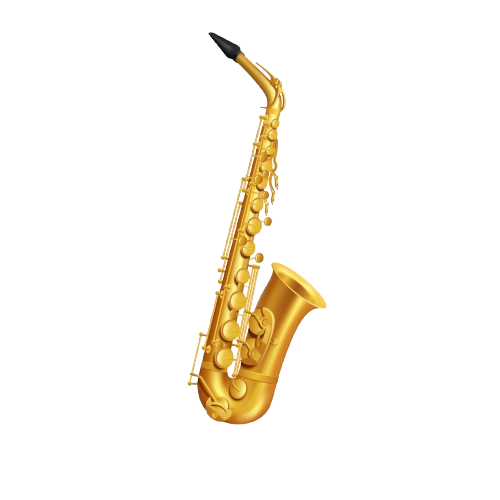

 <div align="center">



# MALELE

### *Songs with an African heartbeat.*

**AI music creation with a real African soul.**

Compose, generate, produce, and share original African music from a single prompt or a full studio.

<br/>

[](https://developer.android.com)
[](https://kotlinlang.org)
[](https://developer.android.com/jetpack/compose)
[](https://fastapi.tiangolo.com)
[](https://www.postgresql.org)
[](https://redis.io)

<br/>

**POWERED BY AI**

[](https://elevenlabs.io)
[](https://anthropic.com)
[](https://fal.ai)
[](https://openai.com)

<br/>

[](https://github.com/Benjakusa/malele)
[](./docs/LICENSES.md)
[](https://github.com/Benjakusa)

<br/>

*An African sound. A new creative possibility.*

</div>

---

> **PROPRIETARY SOFTWARE | ALL RIGHTS RESERVED**
>
> **Owner:** Benard Oloo Ochieng  
> **Contact:** +254 722 839 617  
> **Copyright:** © 2026
>
> This software and its source code are the exclusive intellectual property of **Benard Oloo Ochieng**. No part of this repository may be copied, modified, distributed, sublicensed, reverse-engineered, or used in any form without prior written consent. Unauthorized use will be pursued to the fullest extent of applicable law.

---

## Contents

| # | Section |
|:---:|---|
| 01 | [The Vision](#01-the-vision) |
| 02 | [Core Capabilities](#02-core-capabilities) |
| 03 | [African Music Intelligence](#03-african-music-intelligence) |
| 04 | [Supported Languages](#04-supported-languages) |
| 05 | [Architecture](#05-architecture) |
| 06 | [Technology Stack](#06-technology-stack) |
| 07 | [Project Structure](#07-project-structure) |
| 08 | [Development Status](#08-development-status) |
| 09 | [Documentation](#09-documentation) |
| 10 | [Security and Privacy](#10-security-and-privacy) |
| 11 | [License and Ownership](#11-license-and-ownership) |
| 12 | [Contact](#12-contact) |

---

## 01 | The Vision

African music is one of the richest musical traditions on Earth.

From the interlocking guitars of **Benga** to the rhythms of **Rhumba**, the energy of **Soukous**, the harmonies of **Gospel**, the movement of **Afro-dance**, and the contemporary sounds of **Amapiano**, Africa has an extraordinary musical identity.

Its musical traditions extend across **Highlife, Fuji, Mbalax**, and hundreds of other genres.

Yet the tools to create this music professionally have been locked behind expensive DAWs, steep learning curves, and English-only interfaces.

### Malele changes that.

<div align="center">

| | Our Beliefs |
|:---:|---|
| **01** | **Anyone can make music.** A first-time user should be able to describe a song and hear it back in two minutes. |
| **02** | **African genres deserve dedicated tools.** Benga is not "generic pop with African drums." Each tradition has its own grammar, and Malele honours it. |
| **03** | **AI is a co-producer, not a replacement.** Malele assists you. It never overrides you. Every parameter, note, and word stays in your hands. |

</div>

---

## 02 | Core Capabilities

Malele is organised around **two complementary creative modes** that share one engine, supported by a personal music library and a future community experience.

<table>
<tr>
<td width="50%" valign="top">

### 🎼 Create
**AI Song Generation**

Describe what you want. Pick a genre, a mood, and a language.

Malele writes the lyrics, composes the music, and delivers **two variations** to compare.

Every generated song remains **fully editable**.

</td>
<td width="50%" valign="top">

### 🎛️ Studio
**Beat Making and Vocals**

Compose from scratch with a **step sequencer**, **per-instrument parameters**, and a **mixer**.

Record your own vocals over the beat.

Layer AI-suggested instruments when you want help.

Export to **WAV** or **M4A**.

</td>
</tr>
<tr>
<td width="50%" valign="top">

### 🎵 Library
**Your Archive**

Every generated or produced song lives in your library.

**Replay, edit, share, export**, offline, on your own device.

</td>
<td width="50%" valign="top">

### 🌍 Explore
**Coming Soon**

Discover music made by other Malele creators.

Follow your favourites.

Learn from the community.

</td>
</tr>
</table>

---

## 03 | African Music Intelligence

Malele is built around a **dedicated African genre library**, with structured configuration for each musical tradition.

| Genre | Region | Signature Elements |
|---|---|---|
| **Benga** | Kenya | Interlocking guitars, driving bass, syncopated percussion |
| **Rhumba** | DR Congo | Clave-based rhythm, flowing guitar arpeggios, sebene sections |
| **Soukous** | Congo Basin | Fast interlocking guitars, energetic drums |
| **Gospel** | Pan-African | Choir harmonies, organ, congregational call-and-response |
| **Afro-dance** | Pan-African | 3-3-2 kick pattern, busy percussion, bouncy bass |
| **Reggae** | Pan-African | One-drop drums, offbeat skank, dub delay |
| **Slow African Ballad** | Pan-African | Sparse percussion, warm pads, gentle bass |
| **Amapiano** | South Africa | Log drum bass, airy pads, laid-back shakers |
| **Afro-pop** | Pan-African | Contemporary production, hook-driven |
| **Highlife** | West Africa | Guitar-driven melody, horn sections |
| **Custom** | Yours | User-defined genre, sub-genre, or fusion |

> **Every genre is a starting point, not a boundary.**

Users retune tempo, swing, instruments, and arrangement to their taste.

---

## 04 | Supported Languages

Malele is designed to create music in the languages of its users.

<div align="center">

[](./docs/PLAN.md)
[](./docs/PLAN.md)
[](./docs/PLAN.md)
[](./docs/PLAN.md)
[](./docs/PLAN.md)
[](./docs/PLAN.md)
[](./docs/PLAN.md)
[](./docs/PLAN.md)

</div>

**Honest disclaimer:** AI language quality varies. Not every language is equally well supported by current AI providers. Users should evaluate output in their own language. Malele does not claim native-level fidelity for every language.

---

## 05 | Architecture

Malele uses a **three-layer architecture** with strict boundaries.

### System Architecture

```text
┌─────────────────────────────────────────────────────────────┐
│                     ANDROID APPLICATION                     │
│                                                             │
│              Kotlin · Compose · Hilt · Room · Media3        │
└──────────────────────────────┬──────────────────────────────┘
                               │
                         HTTPS + JWT
                               │
                               ▼
┌─────────────────────────────────────────────────────────────┐
│                    MALELE BACKEND (FastAPI)                  │
│                                                             │
│       Auth · Jobs · Credits · Provider Router · Storage     │
└──────────────┬───────────────┬──────────────┬────────────────┘
               │               │              │
               ▼               ▼              ▼
       ┌────────────┐  ┌────────────┐  ┌────────────┐
       │   MUSIC    │  │   LYRICS   │  │   IMAGE    │
       │            │  │            │  │            │
       │ ElevenLabs │  │ Anthropic  │  │  OpenAI    │
       │  fal.ai    │  │  Claude    │  │            │
       └────────────┘  └────────────┘  └────────────┘
               │               │              │
               └───────────────┴──────────────┘
                               │
                               ▼
                    ┌────────────────────┐
                    │    DATA LAYER      │
                    │                    │
                    │    PostgreSQL      │
                    │    Redis           │
                    └────────────────────┘
```

### Key Architectural Principles

- **Provider keys never touch the app.** All AI calls go through the backend.
- **Provider-independent.** Every AI is behind an interface. Providers can be swapped without changing app code.
- **Async by design.** Music generation is a job queue, ensuring no blocking UI.
- **Cost-aware.** Every provider call is tracked, reserved, and refunded on failure.

---

## 06 | Technology Stack

Malele combines native Android development, a modern Python backend, scalable data infrastructure, and multiple AI integrations.

### Android Application

<div align="center">


</div>

### Backend Service

<div align="center">


</div>

### Data and Infrastructure

<div align="center">


</div>

### AI Integrations

<div align="center">


</div>

### Developer Tools

<div align="center">


</div>

---

## 07 | Project Structure

```text
malele/
│
├── android/                       # Android application
│   ├── app/                       # Application module
│   ├── core/                      # Shared modules
│   │   ├── audio/                 # Audio engine and synthesis
│   │   ├── common/                # Utilities
│   │   ├── database/              # Room DAOs
│   │   ├── design/                # Theme and design system
│   │   ├── model/                 # Domain models
│   │   ├── network/               # Retrofit clients
│   │   └── storage/               # File I/O and cache
│   │
│   ├── feature/                   # Feature modules
│   │   ├── auth/                  # Login and registration
│   │   ├── create/                # AI generation UI
│   │   ├── generation/            # Job polling and progress
│   │   ├── library/               # Song library
│   │   ├── player/                # Media3 playback
│   │   ├── studio/                # Beat maker and vocals
│   │   └── ...                    # Other features
│   │
│   └── gradle/                    # Version catalog
│
├── backend/                       # FastAPI service
│   ├── app/
│   │   ├── api/                   # HTTP routes
│   │   ├── auth/                  # JWT and Argon2id
│   │   ├── generation/            # Job orchestration
│   │   ├── providers/              # Music, lyrics, image adapters
│   │   │   ├── music/             # ElevenLabs, fal, mock
│   │   │   ├── lyrics/            # Anthropic
│   │   │   └── images/            # OpenAI
│   │   ├── services/              # Business logic
│   │   ├── storage/               # S3 abstraction
│   │   └── workers/               # Celery tasks
│   │
│   ├── migrations/                # Alembic migrations
│   └── tests/                     # Pytest suite
│
├── docs/                          # Architecture and specifications
├── assets/                        # Brand assets, samples
├── scripts/                       # Developer and deployment scripts
└── docker-compose.yml             # Local development stack
```

---

## 08 | Development Status

Malele is being developed through a structured 10-phase roadmap.

<div align="center">

| Phase | Focus | Status |
|:---:|---|:---:|
| **0** | Planning, research, documentation |  |
| **1** | Backend foundation (auth, jobs, credits) |  |
| **2** | AI provider integrations |  |
| **3** | Android foundation and design system |  |
| **4** | Create experience (generation, playback, save) |  |
| **5** | Song results, player, library |  |
| **6** | Song editing and version control |  |
| **7** | Studio Composer and vocal recording |  |
| **8** | Explore, community, creator profiles |  |
| **9** | Production deployment, credits UI, release |  |

</div>

---

## 09 | Documentation

Full project documentation lives in [`docs/`](./docs).

| Document | Purpose |
|---|---|
| [**PLAN.md**](./docs/PLAN.md) | 10-phase roadmap with acceptance gates |
| [**ARCHITECTURE.md**](./docs/ARCHITECTURE.md) | System, Android, backend, database |
| [**DECISIONS.md**](./docs/DECISIONS.md) | All architecture decision records (ADRs) |
| [**IMPLEMENTATION_STATUS.md**](./docs/IMPLEMENTATION_STATUS.md) | Live status board |
| [**KNOWN_GAPS.md**](./docs/KNOWN_GAPS.md) | Deferred features and open questions |
| [**TESTING.md**](./docs/TESTING.md) | Testing strategy and coverage policy |
| [**SECURITY.md**](./docs/SECURITY.md) | Threat model, auth, incident response |
| [**LICENSES.md**](./docs/LICENSES.md) | Third-party license attribution |
| [**API_INTEGRATIONS.md**](./docs/API_INTEGRATIONS.md) | Provider capabilities and terms |
| [**COST_MODEL.md**](./docs/COST_MODEL.md) | Unit costs and provider economics |

---

## 10 | Security and Privacy

Malele takes user trust seriously.

| Control | Detail |
|---|---|
| **API Keys** | Never touch the Android app. All provider calls go through the backend. |
| **Passwords** | Hashed with Argon2id, not bcrypt, not PBKDF2. |
| **Tokens** | Stored in Android's EncryptedSharedPreferences, never in plain files. |
| **Privacy** | Private songs remain private. No generated music is published without explicit action. |
| **Ownership** | Users own their generated music. Malele grants no rights to user content beyond service operation. |
| **Voice** | No voice cloning of real people without consent. The AI is instructed to refuse impersonation. |
| **Copyright** | No copyrighted lyrics are stored or generated. A validator runs before any lyrics reach a provider. |

Full details in [**SECURITY.md**](./docs/SECURITY.md).

---

## 11 | License and Ownership

<div align="center">

### PROPRIETARY · ALL RIGHTS RESERVED

**© 2026 Benard Oloo Ochieng**

</div>

This repository and its contents are **confidential and proprietary**. Access is granted on a need-to-know basis.

**Any redistribution, modification, reverse-engineering, or commercial use without the express written permission of the owner is strictly prohibited.**

Third-party dependencies are used under their respective licenses. See [**LICENSES.md**](./docs/LICENSES.md) for the full inventory.

The name **"Malele"**, the woven African band visual identity, and the proprietary audio composition system are **trademarks and trade secrets** of Benard Oloo Ochieng.

---

## 12 | Contact

<div align="center">


### Benard Oloo Ochieng

**Phone:** +254 722 839 617

**Location:** Kenya

**GitHub:** [github.com/Benjakusa](https://github.com/Benjakusa)

*For business, licensing, or partnership enquiries, please contact the owner directly.*

</div>

---

<div align="center">

# MALELE

### *Songs with an African heartbeat.*

<br/>

[](#malele)

<br/>

**Built with intention. Owned with pride.**

<br/>

*© 2026 Benard Oloo Ochieng · All Rights Reserved*

</div>
